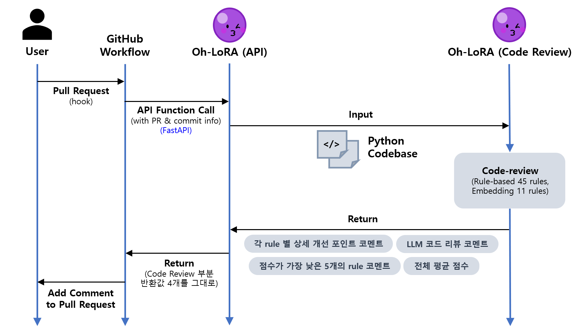

## 목차

* [1. 개요](#1-개요)
* [2. 상세 프로세스](#2-상세-프로세스)
  * [2-1. 코드 리뷰 결과 반환 값 상세 예시](#2-1-코드-리뷰-결과-반환-값-상세-예시) 
* [3. 관련 파일](#3-관련-파일)

## 1. 개요

* Oh-LoRA 👱‍♀️ 의 코드 리뷰를 위한 GitHub Workflow 프로세스
* Oh-LoRA API 함수 구동을 위한 서버는 **개인 PC (GPU 포함)** 에 구현
  * 이유: GitHub 개인 무료 플랜의 Workflow (GitHub-hosted runner) 은 **GPU를 지원하지 않음** [(참고)](https://docs.github.com/ko/actions/reference/runners/github-hosted-runners)
  * 이에 따라, 코드 리뷰 프로세스에 포함된 **임베딩 모델 및 LLM** 의 처리 (inference) 속도를 고려할 때, 개인 PC가 보다 나은 선택으로 판단됨

## 2. 상세 프로세스



* 기본 프로세스
  * 사용자가 Pull Request 를 등록하면, **코드 리뷰 프로세스를 처리하는 GitHub Workflow** 가 hook 으로 동작
  * GitHub Workflow는 **Oh-LoRA 👱‍♀️ 의 코드 리뷰 API 함수** 호출
  * Oh-LoRA 의 코드 리뷰 API 함수에서 코드 리뷰 시스템을 호출, 코드 리뷰 실시
  * 코드 리뷰 결과 반환값을 위 그림처럼 순차적으로 반환한 후, 이를 기반으로 해당 Pull Request 에 자동으로 코멘트 작성

* 상세 코드 리뷰 프로세스
  * [해당 문서](../code_reviewer/README.md) 참고.

### 2-1. 코드 리뷰 결과 반환 값 상세 예시

[예시 코멘트 출처](https://github.com/WannaBeSuperteur/AI_Projects/pull/71)

* 각 rule 별 상세 개선 포인트 코멘트

```markdown
# 🛠 All Fix Suggestions by Oh-LoRA

## 규칙: 중복되는 사항 common 으로 빼기
### 파일: `backend\entire_process.py`
 - 함수: `(최상위 레벨)`
   - line `121` 에 있는 ` (newline)  (newline) FINAL (W/O LLM) [[ `

 - 함수: `run_entire_process`
   - line `96` 에 있는 `top_items_eval_summary`
   - line `97` 에 있는 `code_review_result_str`

### 파일: `backend\run_fastapi.py`
 - 함수: `get_actual_sha_and_changed_files`
   - line `184` 에 있는 `FETCH_HEAD`

 - 함수: `review_pr`
   - line `260` 에 있는 `[ First 5 Files ] (newline) `

...
```

* LLM 코드 리뷰 코멘트

```
전체 흐름을 놓고 보면 하나의 함수가 너무 많은 일을 하고 있어요. 차분하게 책임별로 나누고 docstring을 붙이면 테스트와 수정이 한결 수월해져요!
```

* 점수가 가장 낮은 5개의 rule 코멘트

```
[숫자 값은 위쪽에 상수로] : 35.0 점 🚨, 
[지나치게 많은 들여쓰기 수정] : 25.2 점 🚨, 
[중복되는 사항 common 으로 빼기] : 8.3 점 🚨, 
[README.md, pyproject.toml 필요] : 0.0 점 🚨, 
[100 line 이상 함수 분리, docstring 필요] : 0.0 점 🚨
```

* 전체 평균 점수

```
65.9 / 100.0
```

## 3. 관련 파일

* [코드 리뷰 API 함수 파일 (run_fastapi.py)](run_fastapi.py)
  * 실제 API 함수 (FastAPI 구현) 는 해당 파일의 `review_pr` 함수 (line 206) 
* [GitHub Workflow 파일 (ai_review.yml)](../../.github/workflows/ai_review.yml)
